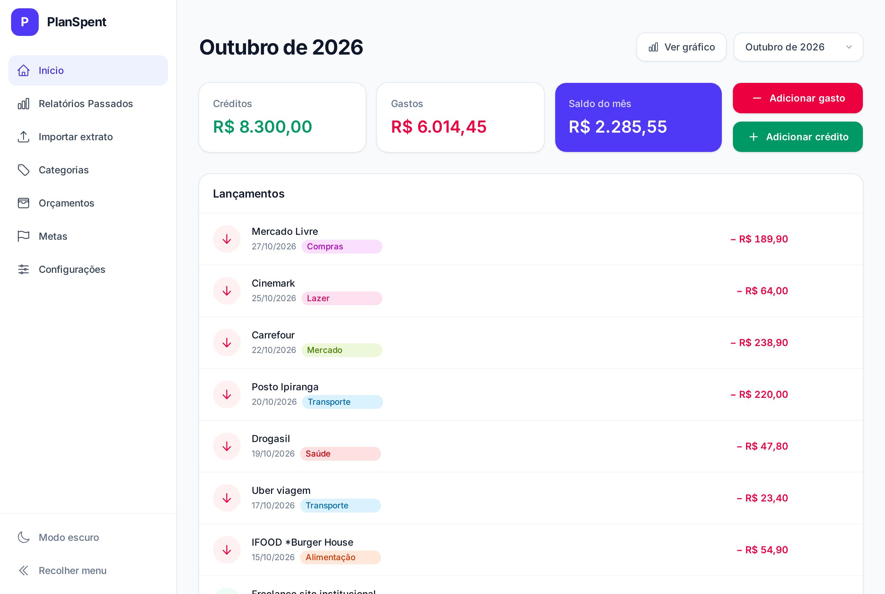
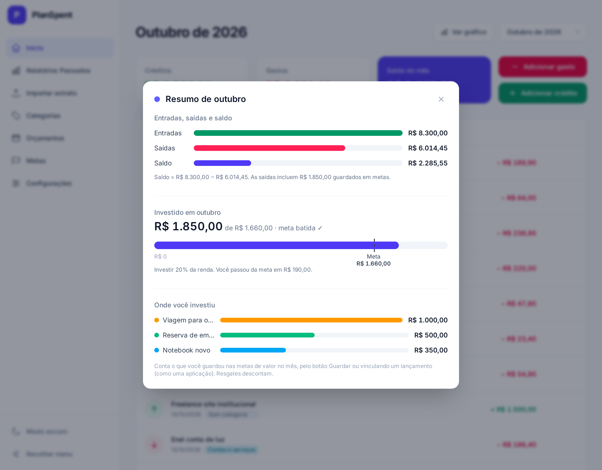
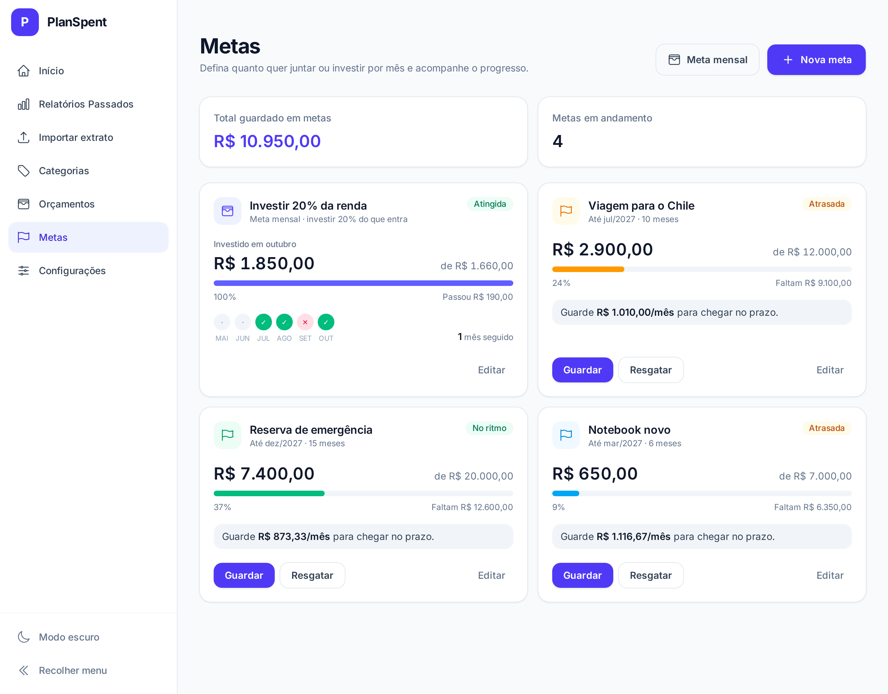
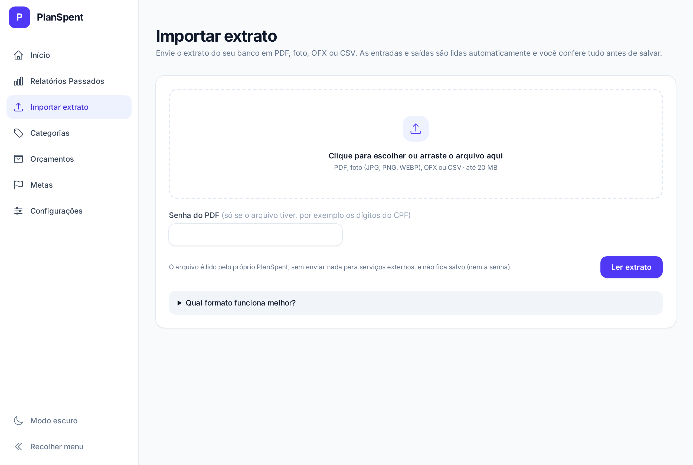
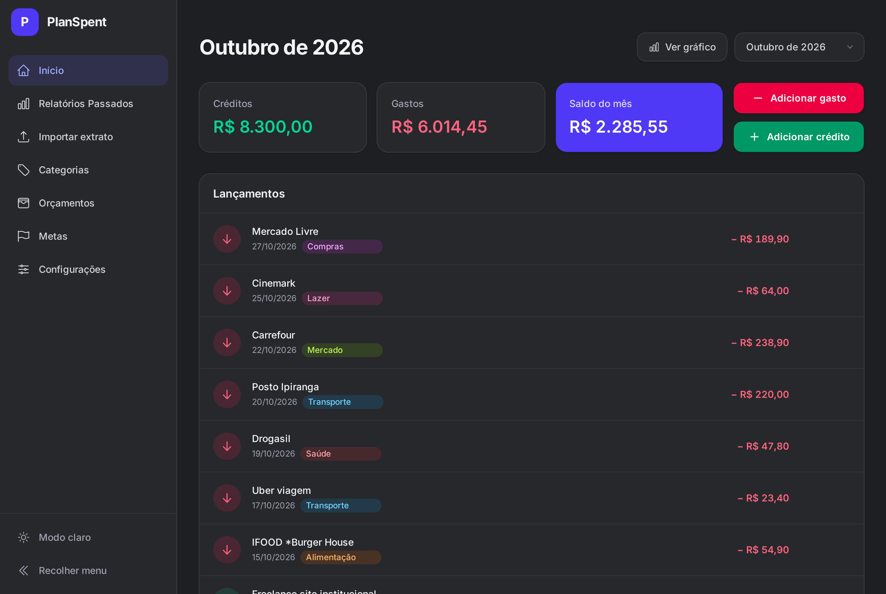

# PlanSpent

[](https://github.com/iarhel-saboia/planspent/actions/workflows/ci.yml)

A personal expense organizer built with **Ruby on Rails 8**. It tracks the month's income and expenses, imports bank statements (OFX, CSV, PDF and even photos of a statement), categorizes entries automatically and follows savings goals.

Everything runs locally and for free: no paid APIs, no external AI and no bank data sent to third parties.

The interface is in Brazilian Portuguese, and the statement parser targets Brazilian bank formats.



| Monthly summary | Goals |
|---|---|
|  |  |
| **Statement import** | **Dark mode** |
|  |  |

<sub>Screenshots use fictional sample data.</sub>

## Features

- **Monthly entries**: income, expenses and balance, with a month selector and live updates through Turbo.
- **Statement import**
  - Supports **OFX**, **CSV**, **PDF** (including password-protected files) and **images or scanned PDFs** through OCR (Tesseract).
  - A custom text parser handles Brazilian statement layouts: signs before or after the amount, `D`/`C`, `(+)`/`(-)`, and descriptions split across several lines. It also skips balance lines and strips CPF/CNPJ (Brazilian tax IDs) and document numbers.
  - A review screen before saving, with an automatic goal suggestion for each entry.
  - Files are processed in memory and never stored.
- **Automatic categorization without AI**
  - Keyword rules in [`config/category_rules.yml`](config/category_rules.yml).
  - Merchant memory: when you correct an entry's category, the app learns it and re-categorizes similar entries.
- **Goals**
  - **Savings goals** (e.g. "Trip — R$ 6,000 by Jan 2027"): progress, how much to set aside each month and status (on track, behind, completed). Contributions and withdrawals become entries in the statement.
  - **Monthly goals**: invest a fixed amount or a share of income every month, with a history and a streak of months achieved.
- **Monthly summary**: charts of income × expenses × balance, of how much was invested against the target, and of where the money went. The charts are built with plain HTML and CSS, without a charting library.
- **Reports**: balances of previous months.
- Light and dark themes and a responsive layout.

## Tech stack

| Layer | Technologies |
|---|---|
| Backend | Ruby 4.0, Rails 8.1, SQLite |
| Frontend | Hotwire (Turbo + Stimulus), Tailwind CSS 4, Importmap, Propshaft (no Node, no JS build step) |
| Statements | `pdf-reader`, `csv`, custom OFX parser, Tesseract + Poppler for OCR |
| Quality | Minitest, RuboCop, Brakeman, bundler-audit, GitHub Actions |

## Getting started

**Requirements:**
- Ruby 4.0.5 (see `.ruby-version`).
- Optional, to import images and scanned PDFs: Tesseract and Poppler. On Debian/Ubuntu:

```bash
sudo apt install tesseract-ocr tesseract-ocr-por poppler-utils
```

**Setup:**

```bash
git clone git@github.com:iarhel-saboia/planspent.git
cd planspent
bin/setup        # installs gems, creates the database with the default categories and a few sample entries, and starts the server
```

Later, to start the server with Tailwind rebuilding automatically, use:

```bash
bin/dev
```

The app runs at http://localhost:3000.

## Tests and quality

```bash
bin/rails test               # model, service, helper and controller tests
bin/rubocop                  # code style
bin/brakeman --no-pager      # security analysis
```

GitHub Actions runs the same tests and checks on every push.

## Project structure

```
app/services/statement_parser.rb     # picks the parser by file type
app/services/statement_parser/       # ofx, csv, pdf, ocr and the text parser
app/services/entry_categorizer.rb    # merchant memory + keyword rules
app/models/goal.rb                   # savings and monthly goals, monthly targets and history
app/helpers/month_chart_helper.rb    # scales for the monthly summary charts
config/category_rules.yml            # keywords per category (editable)
```

## Privacy

- Statements are read in memory and discarded after import.
- PDF passwords are never saved.
- Data lives in the local SQLite database, outside the repository.

---

Made by [iarhel-saboia](https://github.com/iarhel-saboia).
